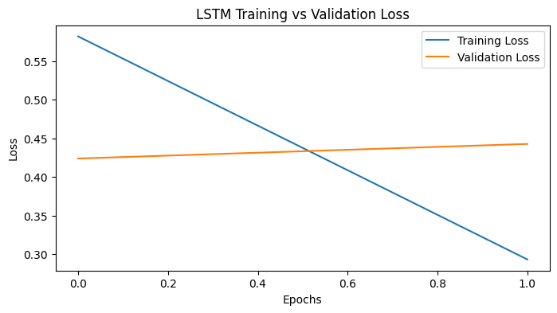
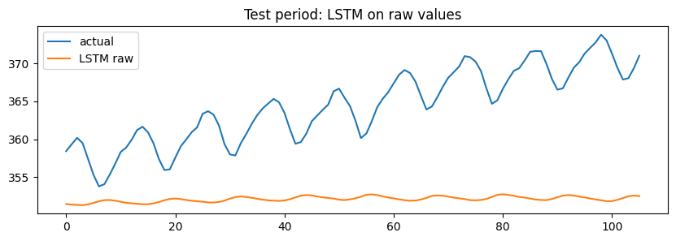
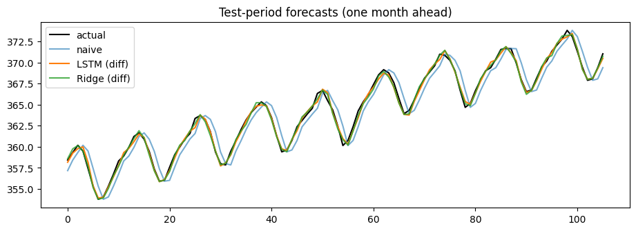
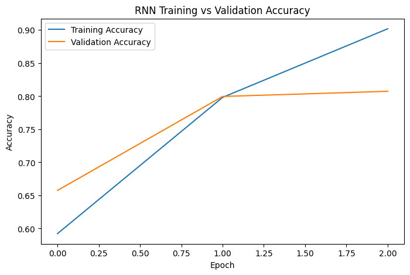

# When does an LSTM actually win? Sequence models vs simple baselines

Three real-world sequence problems, each solved twice: once with a deep learning model (LSTM / BiLSTM) and once with a simple baseline. The goal was not to "use deep learning" but to decide **what an engineer should ship**, using accuracy, latency, model size and explainability.

**Short answer:** the simple baseline matched or beat the LSTM in all three projects on these datasets. The LSTM only became competitive after the right preprocessing (differencing the time series).


## Results at a glance

| Project | Business question | Deep learning model | Baseline | Winner |
|---|---|---|---|---|
| A. Sentiment analysis | Is this review positive or negative? | BiLSTM, F1 **0.824** | TF-IDF + Logistic Regression, F1 **0.881** | Baseline |
| B. Next-word prediction | Suggest the next word while typing | LSTM, top-3 accuracy **16.5%** | Bigram table, top-3 accuracy **15.0%** | LSTM, by 1.5 points |
| C. CO₂ forecasting | What will next month's value be? | LSTM on differences, MAE **0.289** | Ridge on differences, MAE **0.257** | Baseline |

All numbers come from the saved outputs in [`notebooks/01_lstm_three_industry_projects.ipynb`](notebooks/01_lstm_three_industry_projects.ipynb).

## Project A: Sentiment analysis (IMDB reviews)

- **Data:** 8,000 training and 2,000 test reviews from the IMDB dataset, balanced 50/50, padded to 200 tokens.
- **Models:** TF-IDF + Logistic Regression vs a bidirectional LSTM with a 10,000-word embedding.

| Model | F1 | Train time | Prediction time (2,000 reviews) | Parameters |
|---|---|---|---|---|
| TF-IDF + LogReg | **0.881** | 8.6 s | **0.75 s** | 20,001 |
| BiLSTM | 0.824 | 120 s | 5.17 s | 706,177 |



Validation loss started rising after the first epoch while training loss kept falling, so the BiLSTM began to overfit almost immediately on 8,000 reviews.

**Decision:** for a service handling millions of reviews a day, I would ship the TF-IDF baseline. It is more accurate here, about 7x faster at prediction time, 35x smaller, and its word weights explain each prediction to support staff.

**Error analysis:** I tested both models on my own probe sentences with negation ("not good"), sarcasm and mixed opinions. These are the cases where a bag-of-words model is expected to struggle, and where a sequence model is worth revisiting with more data.

## Project B: Next-word prediction (Shakespeare text)

- **Data:** 71,972 tokens, 5,000-word vocabulary covering 96.9% of the text, 10-word input windows built with `timeseries_dataset_from_array`.
- **Model:** embedding + LSTM + softmax over the vocabulary, plus a `suggest_next()` function that returns the 3 most likely next words.

| Model | Top-3 accuracy |
|---|---|
| Bigram lookup table | 15.0% |
| LSTM | **16.5%** |

**Decision:** the gap is only 1.5 points. For a keyboard on low-end phones I would ship the bigram (or trigram) table: it is tiny, instant, easy to update weekly with new slang, and can run fully on-device for privacy. For a "write my email" assistant that needs longer context, a neural model is worth its cost.

## Project C: Time-series forecasting (Mauna Loa CO₂)

- **Data:** 526 monthly CO₂ readings in ppm (bundled with `statsmodels`).
- **Task:** forecast one month ahead on a held-out test period.

| Model | Test MAE (ppm) |
|---|---|
| Ridge regression on differences | **0.257** |
| LSTM on differences | 0.289 |
| Naive (last month) | 1.130 |
| Seasonal naive (12 months ago) | 1.631 |
| LSTM on raw values | 12.268 |



The first LSTM, trained on raw values, produced a flat line and missed the upward trend completely. Its `tanh` activations cannot extrapolate to values higher than anything seen in training.



**Fix:** predicting the month-to-month *change* instead of the raw value cut the LSTM's error from 12.27 to 0.29. A Ridge regression on the same differences did slightly better (0.257).

**Decision:** for a single series with ~500 points, I would deploy Ridge. An LSTM becomes the better choice with many related series, extra input variables and enough data to learn nonlinear patterns, for example demand forecasting across thousands of products.

## Also included: RNN sentiment baseline

[`notebooks/02_rnn_imdb_sentiment.ipynb`](notebooks/02_rnn_imdb_sentiment.ipynb) trains a SimpleRNN (embedding 32 + RNN 32) on the full 25,000-review IMDB set for 3 epochs and reaches **81.1% test accuracy**.



The same notebook contains a CNN for CIFAR-10 image classification. That section has not been run yet, so it has no results.

## What I learned

1. **Always build a baseline first.** In all three projects a simple model set a bar the LSTM struggled to clear.
2. **Preprocessing matters more than architecture.** Differencing the series improved the LSTM's error by about 40x; changing the network would not have.
3. **Accuracy is not the only metric.** Latency, size, cost and explainability decided two of the three recommendations.
4. **Read the learning curves.** Rising validation loss showed overfitting after one epoch, which the final F1 score alone would have hidden.

## Run it yourself

The notebooks run on Google Colab (free GPU) or locally:

```bash
pip install -r requirements.txt
jupyter notebook notebooks/
```

Datasets download automatically (IMDB and Shakespeare via Keras/TensorFlow, CO₂ via `statsmodels`).

## Project structure

```
notebooks/
  01_lstm_three_industry_projects.ipynb   # Projects A, B and C with written decisions
  02_rnn_imdb_sentiment.ipynb             # SimpleRNN on IMDB (+ unrun CNN section)
results/                                  # charts exported from the notebooks
```

## Credits

Built during my AI/ML training. The project brief and task structure came from the course materials. The code, experiments, results and written decisions are my own.
